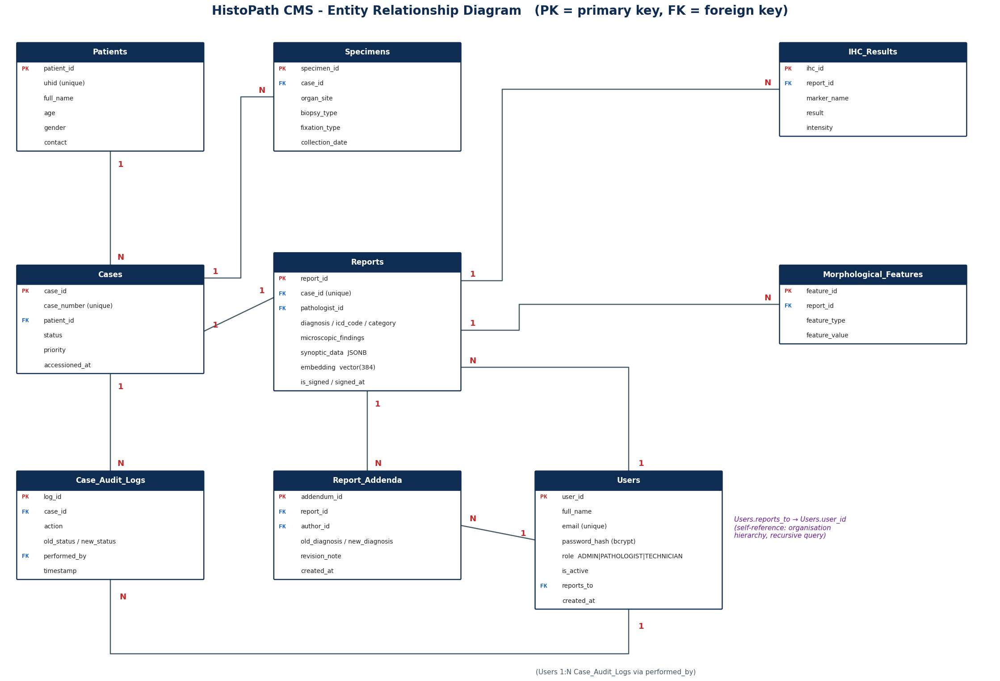

# HistoPath CMS – Project Documentation

## 1. ER diagram

Cardinalities: Patient 1—N Case · Case 1—N Specimen · Case 1—1 Report · Report 1—N IHC_Results ·
Report 1—N Morphological_Features · Report 1—N Report_Addenda · Case 1—N Case_Audit_Logs ·
User 1—N Reports (pathologist) · User 1—N Addenda (author) · User 1—N Audit logs · User 1—N User (reports_to).

## 2. Relational schema (keys, relationships, constraints)
PK = primary key, FK = foreign key, UQ = unique, CK = check.

| Relation | Attributes | Keys / constraints |
|---|---|---|
| **Users** | user_id, full_name, email, password_hash, role, is_active, reports_to, created_at | PK user_id · UQ email · CK role ∈ {PATHOLOGIST, TECHNICIAN, ADMIN} · FK reports_to → Users(user_id) ON DELETE SET NULL |
| **Patients** | patient_id, uhid, full_name, age, gender, contact, created_at | PK patient_id · UQ uhid · CK age 0‥120 · CK gender |
| **Cases** | case_id, case_number, patient_id, status, priority, accessioned_at | PK case_id · UQ case_number · FK patient_id → Patients (RESTRICT) · CK status ∈ {ACCESSIONED, GROSSING, REPORTED, SIGNED} · CK priority ∈ {ROUTINE, URGENT} |
| **Specimens** | specimen_id, case_id, organ_site, biopsy_type, fixation_type, collection_date | PK specimen_id · FK case_id → Cases (CASCADE) |
| **Reports** | report_id, case_id, pathologist_id, microscopic_findings, diagnosis, icd_code, category, synoptic_data *(JSONB)*, is_signed, signed_at, embedding *(vector 384)*, search_vector *(tsvector)* | PK report_id · UQ case_id (1 case = 1 report) · FK case_id → Cases · FK pathologist_id → Users · CK category · CK signed ⇒ signed_at NOT NULL |
| **IHC_Results** | ihc_id, report_id, marker_name, result, intensity | PK ihc_id · FK report_id → Reports (CASCADE) |
| **Morphological_Features** | feature_id, report_id, feature_type, feature_value | PK feature_id · FK report_id → Reports (CASCADE) |
| **Report_Addenda** | addendum_id, report_id, author_id, revision_note, old_diagnosis, new_diagnosis, created_at | PK addendum_id · FK report_id → Reports · FK author_id → Users |
| **Case_Audit_Logs** | log_id, case_id, action, old_status, new_status, performed_by, timestamp | PK log_id · FK case_id → Cases · FK performed_by → Users |

Normalisation: all tables are in 3NF (no transitive dependencies; patient data, case data, specimen data
and report data are separated; repeating groups – IHC markers, morphology – are child tables).
The only deliberately denormalised-looking columns are `Reports.search_vector` and `Reports.embedding`,
which are *derived* data kept for query speed.

## 3. Technology justification
| Choice | Why |
|---|---|
| **PostgreSQL** | Strong ACID transactions (sign-off must be atomic), rich constraints, triggers, stored procedures, roles/GRANT for real database-level RBAC, views, recursive CTEs. |
| **pgvector (vector DB feature)** | Pathology reports are free text; meaning-based "find similar cases" needs embeddings. pgvector keeps vectors **in the same database** as the clinical rows, so one transaction updates text + vector, and one SQL query can join similarity with patient/organ filters. HNSW index + cosine distance (`<=>`). |
| **JSONB (NoSQL-style)** | `synoptic_data` stores semi-structured, per-organ synoptic fields without schema changes; GIN-indexed. |
| **Full-text search (tsvector + GIN)** | Fast keyword search over diagnosis / findings. |
| **sentence-transformers all-MiniLM-L6-v2** | Small (384-dim), free, runs locally – no patient text leaves the machine. |
| **Next.js + React** | File-based routing, API routes give a backend in the same project, easy SPA-style UI. |
| **JWT + bcrypt** | Stateless auth; passwords never stored in plain text. |

## 4. Rubric → where to find it
| # | Evaluation component (marks) | Where it is implemented |
|---|---|---|
| 1 | ER diagram (2) | `docs/ER_diagram.png` |
| 2 | Relational schema with keys, relationships, constraints (3) | §2 above + `sql/01_schema.sql` |
| 3 | SQL implementation – DDL with constraints (4) | `sql/01_schema.sql` (PK, FK, UNIQUE, CHECK, DEFAULT, NOT NULL, indexes) |
| 4 | NoSQL / Vector DB creation (4) | `vector(384)` column + HNSW index (`01_schema.sql`), JSONB `synoptic_data`; data loaded by `scripts/load_data.py` |
| 5 | Technology justification (1) | §3 above |
| 6 | DML operations (4) | `sql/08_dml_and_queries.sql` §A + live in app (add case, sign off, edit, delete, user admin) |
| 7 | Nested / correlated / recursive queries, joins (4) | `sql/08_dml_and_queries.sql` §B-F; live on **SQL Insights** page (`/insights`) and **Admin → hierarchy** (recursive) |
| 8 | Advanced SQL: procedure/function, trigger, CTE (6) | Functions `sign_off_report`, `get_turnaround_time`, `suggest_differential_diagnosis`; **procedure** `add_report_addendum`; triggers `trg_block_signed_report_edit`, `trg_block_signed_report_delete`, `trg_update_search_vector`, `trg_addendum_requires_signed`, `trg_protect_last_admin`, `trg_normalise_email`; CTEs in TAT / differential / insights (`sql/03`, `05`) |
| 9 | NoSQL / Vector feature, **R-U-D** (7) | Report page → *Vector Embedding* card: **Read** (dims, preview, 5 nearest by cosine), **Update** (regenerate / auto re-embed on edit), **Delete** (remove embedding / delete draft with its vector). Semantic search in *Similar Cases*. APIs: `api/vector.js`, `api/report_manage.js`, `api/similar.js` |
| 10 | Next.js interface (3) | `histopath-next/pages/*` |
| 11 | Backend/API & DB integration (2) | `histopath-next/pages/api/*`, `lib/db.js` (pg pool, per-role transactions) |
| 12 | Authentication + ≥2 roles + role-based access in DB (4) | **3 roles** (Admin/Pathologist/Technician); login/register/JWT; UI guard + API guard + PostgreSQL roles with GRANT/REVOKE and column-level grants (`sql/06_rbac_vector.sql`) |
| 13 | Documentation, Git/GitHub (2) | `README.md`, this file, `.gitignore`, git history |
| 14 | Originality, individual contribution, viva (4) | Hybrid semantic + relational search; signed-report immutability by trigger + addenda procedure; DB-enforced RBAC with `SET LOCAL ROLE`; see `docs/VIVA_QA.md` |

## 5. Business rules enforced by the database
* A **signed report cannot be edited or deleted** (triggers); changes go through the `add_report_addendum` procedure.
* **Addenda only for signed reports** (trigger).
* **The last active admin can't be demoted/disabled** (trigger).
* Technicians cannot INSERT/UPDATE reports; nobody except the owner role can read `password_hash` (column-level GRANT).
* Sign-off is one ACID transaction: report → signed, case → SIGNED, audit row written.
